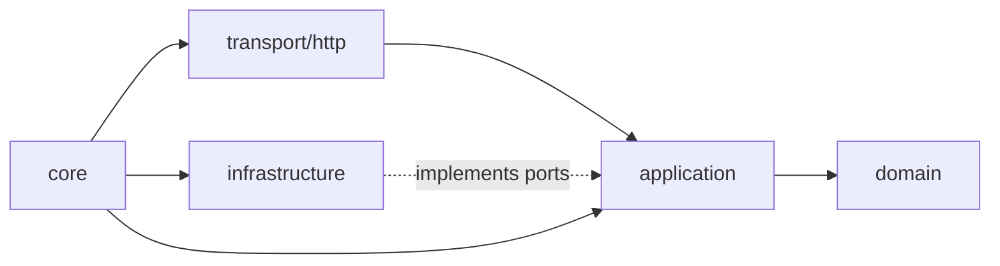

# Архитектура

Приложение разделено на транспортный, прикладной, доменный и инфраструктурный
слои. Зависимости направлены внутрь: HTTP вызывает прикладные сценарии,
сценарии используют доменные типы и порты, а инфраструктура реализует эти
порты. `core` собирает конкретные реализации при запуске.

## Слои и пакеты

| Слой | Пакет | Ответственность |
| --- | --- | --- |
| Транспорт | `backend/app/transport/http/routes` | HTTP-маршруты, сгруппированные по ресурсам; обработчики ошибок — в `backend/app/transport/http/routes/errors.py` |
| Транспорт | `backend/app/transport/http/schemas` | Pydantic-контракты запросов и ответов, сгруппированные по ресурсам |
| Транспорт | `backend/app/transport/http/presenters` | Преобразование результатов сценариев в HTTP-ответы |
| Прикладной | `backend/app/application/campaigns` | Сценарии создания, чтения и редактирования кампаний; команды кампаний |
| Прикладной | `backend/app/application/catalog` | Сценарии поиска офферов и типы результата справочников |
| Прикладной | `backend/app/application/health`, `backend/app/application/operations`, `backend/app/application/offer` | Проверка зависимостей, история операций и проверка оффера |
| Прикладной | `backend/app/application/ports.py` | Узкие Protocol-порты репозиториев и внешних зависимостей |
| Доменный | `backend/app/domain/campaigns` | Сущности кампаний, потоков и офферов в потоке |
| Доменный | `backend/app/domain/catalog` | Доменные типы офферов и справочных значений |
| Доменный | `backend/app/domain/operations` | Доменная запись истории операции |
| Доменный | `backend/app/domain/countries.py`, `backend/app/domain/shares.py` | Правила проверки кода страны и распределения долей |
| Инфраструктура | `backend/app/infrastructure/keitaro` | HTTP-клиент, внешние схемы Keitaro, разбор ответов и мапперы |
| Инфраструктура | `backend/app/infrastructure/repositories` | Адаптеры портов: Keitaro, SQL-аудит, проверка базы и кэш каталога |
| Инфраструктура | `backend/app/infrastructure/persistence` | SQLAlchemy-модели, подключение к БД и SQL-реализации снимков, аудита и идемпотентности |
| Инфраструктура | `backend/app/infrastructure/logging` | Настройка JSON-логирования |
| Сборка | `backend/app/config`, `backend/app/core` | Конфигурация, создание контейнера зависимостей и lifespan приложения |

HTTP-схемы, DTO Keitaro, доменные сущности и ORM-модели — разные типы с разными
владельцами. Транспорт работает с HTTP-схемами и вызывает application-сценарии.
Application оперирует доменными типами и не импортирует Keitaro, FastAPI или
SQLAlchemy. Репозитории переводят внешние схемы и ORM-записи в доменные типы.
Домен не зависит от остальных пакетов приложения.

`backend/app/main.py` создаёт FastAPI-приложение через функцию `create_app(config)`,
подключает маршруты и HTTP-обработчики ошибок.
`backend/app/core/container.py` собирает сценарии и репозитории, а
`backend/app/core/lifespan.py` управляет временем жизни клиента и базы.
Конфигурацию можно передать в `create_app(config)` для изолированных окружений
и тестов.

## Создание кампании

1. HTTP-схема нормализует название и проверяет код страны.
2. Сценарий проверяет оффер и справочники по каталогу — до первой записи.
3. Репозиторий переводит прикладную команду в контракт Keitaro и создаёт кампанию.
4. Сценарий настройки создаёт потоки из конфигурации и сверяет их порядок с Keitaro.
5. Сценарий перечитывает кампанию, проверяет её идентификатор и сохраняет
   снимок кампании, потоков и офферов в локальной базе.
6. Транспортный presenter строит HTTP-ответ из доменных моделей и справочника
   офферов.

Keitaro не предоставляет транзакцию для этого сценария, поэтому удаление
созданной кампании является компенсирующим действием и само может завершиться
ошибкой.

Каждая попытка создания сопровождается объектом `CreationProgress`, который
отслеживает, что уже произошло в Keitaro: `unchanged` (записей нет или они
откатаны), `unknown` (ответ на запрос создания не получен) или `leftover`
(кампания создана и удалить её не удалось). От этого зависит статус аудита и
судьба ключа идемпотентности — маршрут освобождает ключ только при
`unchanged`.

Если настройка потоков или проверка кампании завершается ошибкой, сценарий
удаляет кампанию в Keitaro. Неудачный откат получает статус `rollback_failed`
в аудите. Расхождение сохранённых полей с отправленными (например,
скорректированное название) и сбой локального снимка не отменяют создание: они
попадают в `warnings` ответа и в запись аудита, потому что кампания в Keitaro
уже корректна.

Набор потоков задаётся переменной `CAMPAIGN_STREAMS`. Потоки сортируются по
`position`; поддерживаются схемы `redirect`, `landings` и `action`. В строках и
значениях фильтров можно использовать `{geo}` и `{geo_redirect_url}`. Для потока
с `schema: "landings"` задайте `initial_offer: true`, чтобы добавить в него
начальный оффер.

Повтор создания с тем же `Idempotency-Key` возвращает сохранённый ответ из базы.
Завершённые ключи хранятся 30 дней. Ключ, оставшийся pending больше часа,
требует ручной сверки Keitaro и может быть снят защищённым operations-маршрутом.

## Редактор офферов

`CampaignEditor` работает в одном из двух режимов (`EDITOR_PUBLISH_MODE`).

В режиме `direct` добавление и удаление оффера — одна операция: поток
читается из Keitaro, доли активных офферов пересчитываются до 100%, и
`PUT /streams/{id}` заменяет массив `offers`, сохраняя остальные параметры
потока. Последний активный оффер удалить нельзя.

В режиме `draft` изменения копятся в `stream_offer_snapshots`; каждая строка
хранит пару «опубликовано / черновик» (`published_*` и `draft_*`), поэтому
черновик можно отменить без потерь, а удалённые офферы — вернуть. Закреплённые
доли сохраняются, остаток распределяется между незакреплёнными. Публикация
(`push`) сверяет опубликованную часть снимка с фактическим состоянием потока в
Keitaro: если поток изменили в админке, она отвечает `409` вместо того, чтобы
затереть чужие правки.

`CampaignQueries` при чтении сверяет кампанию и потоки с Keitaro и обновляет
локальный снимок, сохраняя отличающиеся от опубликованного состояния черновики.
Поиск кампаний использует `offset`/`limit` Keitaro и читает страницы по 100,
пока не наберётся лимит совпадений или не закончится список; числовой запрос
открывает кампанию по ID. Сам Admin API не предоставляет фильтр по тексту имени.

Keitaro не поддерживает условную запись, поэтому окно между чтением и записью
потока остаётся: в режиме `direct` оно равно одному запросу, в режиме `draft`
изменение за это окно обнаруживается при публикации.

## Хранение и кэш

Записи аудита хранятся в `audit_log`; локальные снимки прочитанных кампаний,
потоков и опубликованных/черновых офферов — в `campaign_snapshots`,
`stream_snapshots` и `stream_offer_snapshots`. Резервации идемпотентности — в
`idempotency_records`. Alembic обновляет схему, SQL-репозитории возвращают
доменные записи, а не ORM-модели. SQLAlchemy работает через `AsyncSession` на
SQLite или PostgreSQL; столбцы с временем имеют тип `WITH TIME ZONE`, так как
приложение всегда пишет время в UTC с таймзоной.

Каталог хранится в `catalog_cache` с TTL из настроек и доступен всем процессам
с той же базой. Загрузка сериализована локами процесса, а ручное обновление
принудительно перечитывает оба набора. Список офферов читается страницами,
поэтому кэш содержит каталог целиком.
