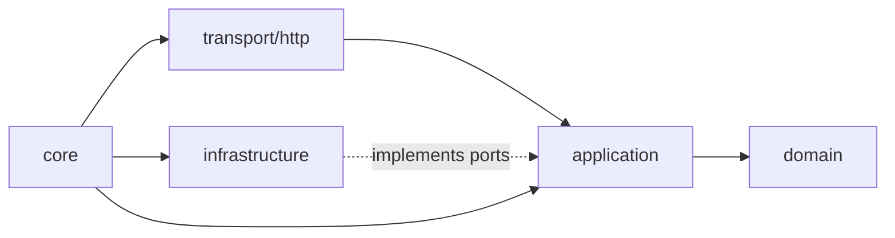

# Архитектура

Приложение разделено на транспортный, прикладной, доменный и инфраструктурный
слои. Зависимости направлены внутрь: HTTP вызывает прикладные сценарии,
сценарии используют доменные типы и порты, а инфраструктура реализует эти
порты. `core` собирает конкретные реализации при запуске.

## Слои и пакеты

| Слой | Пакет | Ответственность |
| --- | --- | --- |
| Транспорт | `backend/app/transport/http/routes` | HTTP-маршруты, сгруппированные по ресурсам; обработчики ошибок — в `backend/app/transport/http/routes/errors.py` |
| Транспорт | `backend/app/transport/http/schemas` | Pydantic-контракты запросов и ответов, сгруппированные по ресурсам |
| Транспорт | `backend/app/transport/http/presenters` | Преобразование результатов сценариев в HTTP-ответы |
| Прикладной | `backend/app/application/campaigns` | Сценарии создания, чтения и редактирования кампаний; команды кампаний |
| Прикладной | `backend/app/application/catalog` | Сценарии поиска офферов и типы результата справочников |
| Прикладной | `backend/app/application/health`, `backend/app/application/operations`, `backend/app/application/offer` | Проверка зависимостей, история операций и проверка оффера |
| Прикладной | `backend/app/application/ports.py` | Узкие Protocol-порты репозиториев и внешних зависимостей |
| Доменный | `backend/app/domain/campaigns` | Сущности кампаний, потоков и офферов в потоке |
| Доменный | `backend/app/domain/catalog` | Доменные типы офферов и справочных значений |
| Доменный | `backend/app/domain/operations` | Доменная запись истории операции |
| Доменный | `backend/app/domain/countries.py`, `backend/app/domain/shares.py` | Правила проверки кода страны и распределения долей |
| Инфраструктура | `backend/app/infrastructure/keitaro` | HTTP-клиент, внешние схемы Keitaro, разбор ответов и мапперы |
| Инфраструктура | `backend/app/infrastructure/repositories` | Адаптеры портов: Keitaro, SQL-аудит, проверка базы и кэш каталога |
| Инфраструктура | `backend/app/infrastructure/persistence` | SQLAlchemy-модели, подключение к БД и реализация репозитория аудита |
| Инфраструктура | `backend/app/infrastructure/cache`, `backend/app/infrastructure/logging` | TTL-кэш и настройка логирования |
| Сборка | `backend/app/config`, `backend/app/core` | Конфигурация, создание контейнера зависимостей и lifespan приложения |

HTTP-схемы, DTO Keitaro, доменные сущности и ORM-модели — разные типы с разными
владельцами. Транспорт работает с HTTP-схемами и вызывает application-сценарии.
Application оперирует доменными типами и не импортирует Keitaro, FastAPI или
SQLAlchemy. Репозитории переводят внешние схемы и ORM-записи в доменные типы.
Домен не зависит от остальных пакетов приложения.

`backend/app/main.py` создаёт FastAPI-приложение через функцию `create_app(config)`,
подключает маршруты и HTTP-обработчики ошибок.
`backend/app/core/container.py` собирает сценарии и репозитории, а
`backend/app/core/lifespan.py` управляет временем жизни клиента и базы.
Конфигурацию можно передать в `create_app(config)` для изолированных окружений
и тестов.

## Создание кампании

1. HTTP-схема нормализует название и проверяет код страны.
2. Application-сценарий проверяет оффер через порт репозитория.
3. Репозиторий переводит прикладную команду в контракт Keitaro и создаёт кампанию.
4. Сценарий настройки создаёт потоки из конфигурации и сверяет их с Keitaro.
5. Сценарий перечитывает кампанию, проверяет её идентификатор и сохраняет
   снимок кампании, потоков и офферов в локальной базе.
6. Транспортный presenter строит HTTP-ответ из доменных моделей и справочника
   офферов.

Keitaro не предоставляет транзакцию для этого сценария, поэтому удаление
созданной кампании является компенсирующим действием и само может завершиться
ошибкой.

Если настройка потоков, проверка кампании или запись локального снимка завершается
ошибкой, сценарий удаляет кампанию в Keitaro. Неудачный откат получает статус
`rollback_failed` в аудите.

Набор потоков задаётся переменной `CAMPAIGN_STREAMS`. Потоки сортируются по
`position`; поддерживаются схемы `redirect`, `landings` и `action`. В строках и
значениях фильтров можно использовать `{geo}` и `{geo_redirect_url}`. Для потока
с `schema: "landings"` задайте `initial_offer: true`, чтобы добавить в него
начальный оффер.

## Изменение офферов

`CampaignEditor` проверяет наличие оффера и принадлежность потока кампании.
Доли распределяются поровну и в сумме дают 100; закреплённые доли остаются
неизменными, а остаток распределяется между остальными активными офферами.
Перед `PUT` репозиторий перечитывает поток, сохраняет его фильтры и остальные
настройки и заменяет только массив `offers`.

Повтор создания с тем же `Idempotency-Key` возвращает сохранённый ответ из базы.
Завершённые ключи хранятся 30 дней. Ключ, оставшийся pending больше часа,
требует ручной сверки Keitaro и может быть снят защищённым operations-маршрутом.
Неизвестный результат внешнего запроса не освобождает ключ автоматически.

Поиск кампаний использует `offset`/`limit` Keitaro и просматривает страницы, пока
не найдёт лимит совпадений или не дойдёт до конца списка. Сам Admin API не
предоставляет фильтр по тексту имени.

Так как API-клиент отправляет весь список, параллельные изменения между чтением
и записью могут конфликтовать. В текущей интеграции нет условной записи или
блокировки на стороне Keitaro.

## Хранение и кэш

Записи аудита хранятся в `audit_log`; снимки созданных кампаний, потоков и
офферов — в `campaign_snapshots`, `stream_snapshots` и
`stream_offer_snapshots`. Alembic обновляет схему, SQL-репозитории возвращают
доменные записи, а не ORM-модели. SQLAlchemy работает через `AsyncSession`.
Каталог хранится в `catalog_cache` с TTL из настроек. Загрузка сериализована
локами процесса, а ручное обновление принудительно перечитывает оба набора.
